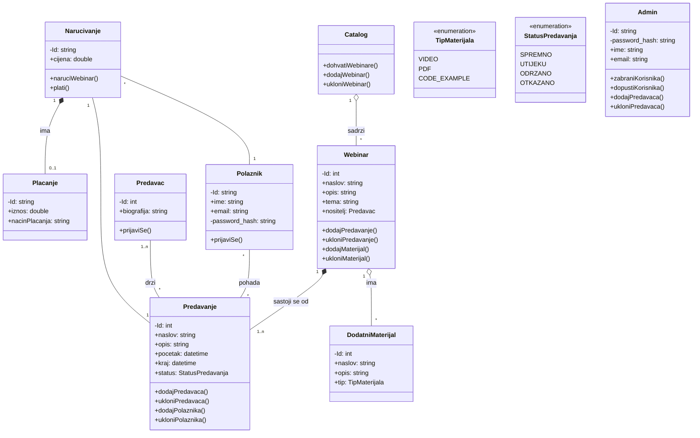

- [[UML shared aggregation]]
- [[UML composite aggregation (composition)]]
- [[Allen Holub's UML Quick Reference]]

- [x] dodaj kompoziciju i agregaciju [[UML composition]], [[UML aggregation]] [^1] [^2]
- [x] tipovi podataka za liste
- [x] provjeri tekst na strelicama, gore dole
- [x] private,public
- [x] dodaj druge klase
- [x] pogledaj **use case**
- [x] pitati ostale za notes 🗒
- [x] pitati druge za Catalog klasu

- [x] poslati mail s dijagramom klasa

- [ ] ==vidjeti sto ce profesor reci za video, tip podataka, vrste veze, dodatne klase, enumeracije, private/public==
	- treba li nam **Catalog**
	- pitati profesora treba li nam pracenje placanja i narudzbi
	
- [ ] pogledati dijagrame **online**

### dodatne klase

- [x] Materijali
- [x] enumaracija statusa predavanja
	- [x] ? trebaju li nam i drugi statusi

- [x] Administrator

**Admin**

- upravljanje korisnicima
- upravljanje predavacima (kreatorima)
- ostalo

### todo

dijagram je u pojednostavljenom konceptu manje-više ok. 

Klasa Predavac i klasa Webinar su već povezane preko klase Predavanje, pa obzirom da klasa Predavac sadrži samo biografiju ne vidim potrebu da ima direktnu vezu prema klasi Webinar, pogotovo ne 1 na 1 jer jedan predavač može držati više webinara i jedan webinar može držati više predavača, a to sve imate riješeno u posrednoj klasi Predavanje, jer webinar se sastoji od (jednog ili više) predavanja.

U tom smislu, **tip veze između Predavanje i Webinar je dobar (kompozicija, predavanje ne može postojati osim u okvirima webinara)** ali obratite pozornost na kardinalnost jer ako u klasi Webinar imate metode dodaj i ukloni predavanje, onda nema smisla da veza bude 1 na 1. %% ovo zapravo nije 1:1, krivi prikaz %%

- Enumeracija tema mislim da nije potrebna
- isto tako i veza između predavača i polaznika
- Predavač i polaznik bi se trebali nekako moći logirati

Moji odgovori:
1. [x] možete dodati nadređenu klasu Katalog webinara koja bi imala metude dodaj / ukloni webinare

2. [x] modifikatori pristupa su bitni u egzaktnom modelu. Na ovoj razini ih je dobro staviti jer su sastavni dio dijagrama ali nisu presudni obzirom da iz dijagrama klasa ne generirate / ne pišete konkretnu implementaciju u nekom objektnom programskom jeziku
3. [x] ako kupujete određeni webinar, ne bi bilo loše imati i **klasu za naručivanje i kompozicijom vezanu klasu Plaćanje.** Sami odredite po dva atrubuta i po bar jednu metodu

- [x] ukloniti vezu Predavac -> Polaznik
- [x] Ukloniti vezu Predavac -> Webinar
- [x] dodati Catalog
- [x] klasa za narucivanje

### dijagram

[^1]: [[UML composite aggregation (composition)]]
[^2]: [[UML shared aggregation]]